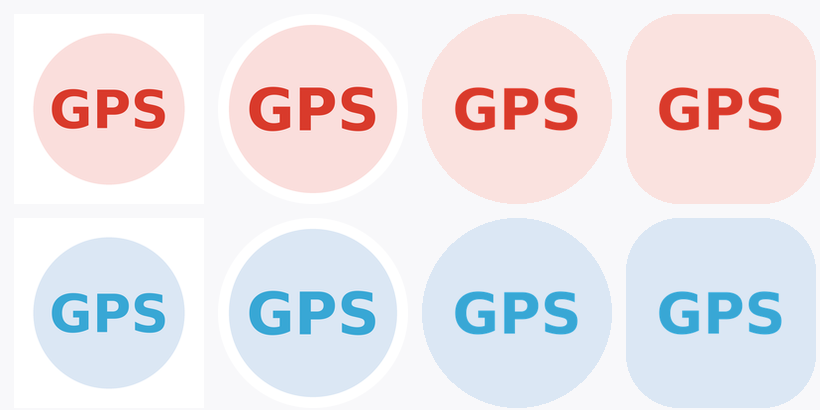

# LaneNav · 车机盒子车道级导航定位方案

把手机的**高精度 GNSS 定位**通过 WiFi TCP 或蓝牙 BLE 转发给车机盒子，盒子侧注入系统定位，让高德车机版 / 导航 SDK 获得手机级的定位质量，从而支持车道级导航。

适用于任意 Android 11+ 手机 + Android 8.0+ 车机盒子。

```
Android 11+ 手机                                   Android 8.0+ 车机盒子
┌──────────────────┐                       ┌────────────────────────┐
│ LocationRelay    │  ① WiFi TCP :19800    │ MockRelay              │
│ 前台定位服务      │ ───────────────────→  │ TCP 客户端 / BLE 客户端  │
│ TCP Server       │  ② BLE GATT (notify)  │ 自动重连 + 扫描          │
│ BLE GATT Server  │ ───────────────────→  │                        │
│                  │ ←───────────────────  │ MockLocationInjector   │
└──────────────────┘   {"cmd":"sleep"}     │   ↓ 写入系统 GPS        │
                                           │ SourceMonitor 来源检测  │
                                           │ 高德车机版 → 车道级导航  │
                                           └────────────────────────┘
```

**两条通道二选一或同时开**，在两端 App 里都可切换：

| 通道 | 优点 | 缺点 |
|------|------|------|
| **BLE 蓝牙** | 不用开热点；手机功耗低一个数量级；自动重连 | 需 MTU 协商与分包；老盒子蓝牙可能只有 4.0 |
| **WiFi TCP** | 带宽大、实现简单、延迟稳定 | 手机必须开热点，持续耗电发热 |
| **双通道** | 互为主备，一条断了另一条兜底 | 手机端两套链路同时工作，耗电最高 |

## 图标



左：手机端（红）　右：盒子端（蓝）。上排方形/圆形兜底，下排自适应图标在圆形与圆角方形下的真实渲染。

## 系统要求

| 端 | 最低版本 | minSdk |
|----|---------|--------|
| 手机端 | Android 11 | 30 |
| 盒子端 | Android 8.0 | 26 |

盒子端下探到 Android 8 是为覆盖老车机；BLE 在 Android 8~12 用的是已废弃但仍生效的回调重载，
代码里两个 `onCharacteristicChanged` 都必须实现，只写新版会导致老系统收不到任何数据。

## 工程结构

```
LaneNav/
├── shared/    共用数据模型 + 传输协议（纯 Kotlin/JVM）
│   ├── LocationPacket.kt   定位数据包 + JSON 序列化
│   ├── WireProtocol.kt     TCP 命令协议
│   └── BleProtocol.kt      BLE UUID + MTU 分包/重组
├── uikit/     深色科技风 UI 构件库（纯代码绘制，两端共用）
│   └── Ui.kt               卡片/分段选择器/指标格/按钮/输入框
├── phone/     手机端 App
│   ├── LocationRelayService.kt  前台定位服务（TCP + BLE 双通道）
│   ├── BleGattServer.kt         BLE GATT Server（广播 + notify）
│   ├── MainActivity.kt          通道切换 + 保活配置
│   └── NetUtils.kt              本机 IP 获取
└── box/       盒子端 App
    ├── MockRelayService.kt      TCP 客户端 + BLE 客户端 + 自动重连
    ├── BleGattClient.kt         BLE 扫描/连接/MTU 协商/分包重组
    ├── MockLocationInjector.kt  写入系统 GPS
    ├── SourceMonitor.kt         检测实际在用谁的 GPS
    ├── BoxConfig.kt             配置存储
    ├── MainActivity.kt          配置界面 + 状态监控
    └── BootReceiver.kt          开机自启
```

## 编译

### 方式一：本机一键编译（已配好工具链，推荐）

```bash
cd LaneNav
./build.sh
```

产物输出到 `dist/`：
- `dist/LaneNav-phone-0.1.0.apk`
- `dist/LaneNav-box-0.1.0.apk`

工具链已装在 `.toolchain/`（Gradle 8.7 + SDK Platform 34 + Build-Tools 34.0.0，共 862MB），
`local.properties` 已指向该 SDK，无需额外配置。

### 方式二：Android Studio

直接 Open 本目录即可。若需命令行编译：

```bash
cd LaneNav
gradle wrapper --gradle-version 8.7
./gradlew :phone:assembleDebug :box:assembleDebug
```

环境要求：JDK 17+、Android SDK Platform 34、Build-Tools 34.x。

### 已知编译要点

| 问题 | 处理 |
|------|------|
| `GRADLE_USER_HOME` 未设置导致 native 库加载失败 | 已固定在 `build.sh` 中 |
| Gradle 官方源下载中断 | 改用腾讯镜像 `mirrors.cloud.tencent.com/gradle/` |
| `Location.verticalAccuracy` 不存在 | 正确属性名是 `verticalAccuracyMeters` |
| `isFromMockProvider` 不可赋值 | Kotlin 中为只读属性，由系统自动置位 |


## 部署步骤

### 1. 手机端（Android 11+）

1. 安装 `phone-debug.apk`
2. 打开 App → 点「启动转发」→ 依次授权：
   - 定位 → **始终允许**（关键，选"仅使用期间"熄屏就断）
   - 通知权限
3. 打开**手机热点**（建议 5GHz，减少延迟抖动）
4. 记下 App 上显示的「本机 IP」，通常是 `192.168.43.1`

**手机必设，否则会出现断流：**

| 项目 | 路径 |
|------|------|
| 省电策略 | 应用信息 → 省电策略 → **无限制** |
| 自启动 | 应用信息 → 自启动 → 允许 |
| 后台锁定 | 最近任务 → 下拉本应用 → 加锁 |
| 锁屏清理 | 开发者选项 → 关闭"锁屏时清除内存" |
| 电池优化 | 设置 → 电池 → 应用耗电管理 → 允许后台运行 |

### 2. 盒子端（Android 8.0+）

1. 安装 `box-debug.apk`
2. 连上手机热点
3. **授权模拟位置**（二选一）：
   - GUI：设置 → 开发者选项 → 选择模拟位置信息应用 → 选「定位注入(盒子端)」
   - ADB（GUI 入口被 ROM 藏了时用）：
     ```bash
     adb shell appops set com.lobster.lanenav.box android:mock_location allow
     ```
4. 打开 App，填入手机 IP（如 `192.168.43.1`），端口 `19800`
5. 选择传输通道：
   - **蓝牙 BLE** → 不需要填手机 IP，直接扫描连接
   - **WiFi TCP** → 填手机 IP（如 `192.168.43.1`）
   - **双通道** → 两者同时启用，互为备份
6. 勾选「启动时自动连接」「开机自启」
7. 点「连接并注入」，状态显示 **RUNNING** + 延迟数值即为成功

### 3. 验证

```bash
# 盒子端看当前系统定位是否已变为手机坐标
adb shell dumpsys location | grep -A5 "gps"
```

或用 **GPSTest**（盒子上装）确认坐标在跳动、精度 ±1~3m。

最后打开**高德车机版**导航，在有高精地图覆盖的高速/快速路上，应出现车道级引导。

## 协议

### 定位流（手机 → 盒子，每行一条 JSON）

```json
{"ts":1761319200123,"lat":26.5821,"lon":101.7012,"alt":1120.5,
 "bearing":273.4,"speed":16.7,"acc":1.2,"vacc":2.0,"fix":"gnss","sats":18}
```

| 字段 | 含义 |
|------|------|
| ts | 采集时间戳 ms |
| lat/lon | 经纬度 |
| alt | 海拔 m |
| bearing | 航向角 0~360（车道级关键） |
| speed | 速度 m/s |
| acc / vacc | 水平 / 垂直精度 m |
| fix | `gnss` 真实卫星 / `fused` 网络融合 / `imu` 推算 |
| sats | 用于定位的卫星数 |

### 控制命令（盒子 → 手机）

```json
{"cmd":"sleep"}   // 静止 >60s，手机降到 0.1Hz
{"cmd":"wake"}    // 开始移动，恢复 1Hz
```

### BLE 分包格式

BLE 单次通知可写字节 = `MTU - 3`。默认 MTU 23 → 仅 20 字节，而一条定位 JSON 约 150 字节，
因此必须分包。每包头部 3 字节：

```
byte[0] = frameId      帧号 0-255（区分并发帧）
byte[1] = chunkIndex   片序号
byte[2] = totalChunks  总片数
byte[3..] = 业务数据
```

单包业务载荷 = `MTU - 3 - 3`：

| MTU | 单包载荷 | 150 字节需几包 |
|-----|---------|---------------|
| 23（默认） | 17 | 9 包 |
| 185 | 179 | 1 包 |
| 517（目标） | 511 | 1 包 |

连接建立后盒子立即 `requestMtu(517)`，协商成功则一包发完，失败则自动分包。
接收端 `BleFrames.Assembler` 按 `frameId` 重组，凑齐后交给 JSON 解析。

### BLE UUID

| 用途 | UUID |
|------|------|
| 主服务 | `5b1ea100-7e57-4b1a-9c3d-2f6a1b0c9d01` |
| 定位数据（notify） | `5b1ea101-7e57-4b1a-9c3d-2f6a1b0c9d01` |
| 控制命令（write） | `5b1ea102-7e57-4b1a-9c3d-2f6a1b0c9d01` |
| CCCD | `00002902-0000-1000-8000-00805f9b34fb` |

## 关键设计决策

**为什么用系统 `LocationManager` 而不是 FusedLocationProvider？**
国行 ROM 常缺 GMS，`FusedLocationProviderClient` 可能直接不可用。`LocationManager` + `GPS_PROVIDER` 在所有机型上都能工作，且能直接读到 `GnssStatus`（卫星数）。

**为什么手机端间隔 1Hz？**
车道级导航的航向角需要连续平滑，10Hz 不必要且耗电。1Hz + 盒子侧注入时保持 `elapsedRealtimeNanos` 单调递增，已足够导航 SDK 平滑。

**精度值为什么要放大？**
`acc` 是图商 SDK 判断"定位可信度"的依据。`fix=imu`（推算）或网络定位时把 `acc` 放大到 30~50m，SDK 会自动切到惯导推算，比硬喂一个高精度假坐标更稳。

**BLE 为什么用 notify 而不是 indicate？**
`notify` 无需等待对端确认，1Hz 定位流下延迟更低；`indicate` 每包要等 ACK，9 包分包时会累积几百毫秒延迟。丢包由下一帧自然覆盖，对定位流可接受。

**BLE 为什么需要分包重组而非依赖大 MTU？**
MTU 协商结果不可控：部分盒子蓝牙栈上限 185，部分 ROM 拒绝 517 请求。若代码假定单包，会在这些设备上收到截断 JSON 并静默解析失败。分包层保证任何 MTU 下都能正确传输。

**为什么手机端 BLE 用单队列串行发送？**
BLE 协议要求等上一包 `onNotificationSent` 回调后才能发下一包，并发写会导致丢包。代码用 `ArrayDeque` + `sending` 标志串行化。

**为什么静止时降频？**
手机持续 GNSS + 热点 + 常驻服务，长时间停放会明显发热耗电。盒子检测速度 ≈0 持续 60 秒就发 `sleep`。

## 已知限制

- **隧道 / 地库**：手机 GNSS 丢失时盒子收到的是推算值，长时间隧道仍需依赖图商 SDK 自身惯导补偿
- **车道级覆盖**：仅有高精地图采集的路段（主要高速、城市快速路）生效，普通道路退化为常规导航
- **模拟位置横幅**：部分 ROM / 应用会提示"正在使用模拟位置"，高德车机版一般不受影响
- **红米中低端单频 GNSS**：精度约 3~5m，车道级效果会打折，建议用双频机型
- **BLE 距离限制**：无遮挡约 10m，手机放车内一般够用；若手机放后备箱或隔金属层可能断连，此时改用 TCP
- **BLE 老设备**：Android 12 盒子若蓝牙仅 4.0 且不支持 MTU 扩展，150 字节 JSON 会拆成 9 包，1Hz 下仍可承受但延迟略增
- **小盒子蓝牙栈缺陷**：个别车机盒子的 BLE 实现不完整（如 `onMtuChanged` 不回调），此时分包层会按默认 20 字节工作，功能不受影响

## 调优建议

| 现象 | 调整 |
|------|------|
| 延迟 >500ms | 手机热点换 5GHz；确认无其他设备占带宽 |
| 频繁断连 | 盒子 WiFi 休眠关闭：`adb shell settings put global wifi_sleep_policy 2` |
| 定位跳动 | 手机端 `minIntervalMs` 调到 500ms，提高采样率 |
| 盒子端不生效 | 确认 `appops` 已授权；`adb shell dumpsys location` 看 provider 是否存在 |
| BLE 扫描不到手机 | 确认手机端已启动且通道选 BLE；检查手机蓝牙已开、未被其他设备占用 |
| BLE 连上但无数据 | 看盒子端 UI 的 MTU 值；`adb logcat -s LaneNavBox LaneNavPhone` 查订阅是否成功 |
| BLE 频繁断连 | 手机放中控台附近；关闭盒子 WiFi 省电；确认手机省电策略为"无限制" |

---

作者微信：`SnownyC`
